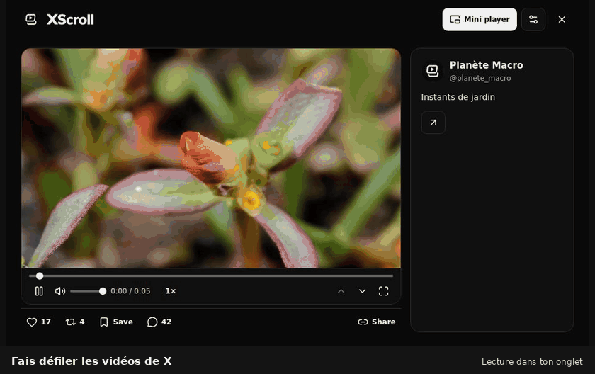

<div align="center">


# XScroll

Fais défiler les vidéos de X et garde-les dans un mini lecteur flottant.

**[Télécharger XScroll pour Chrome](downloads/XScroll.zip?raw=true)**



</div>

## Installer sur Chrome

1. [Télécharge le ZIP](downloads/XScroll.zip?raw=true) et clique sur **Extraire tout**.
2. Sur Windows, double-clique sur **Installer-XScroll.cmd**. Le dossier est préparé, son chemin est copié et Chrome ouvre la page des extensions.
3. Active le **Mode développeur**, puis clique sur **Charger l’extension non empaquetée**. Colle le chemin copié dans le sélecteur et valide. Actualise X.

Sur macOS ou Linux, ouvre `chrome://extensions`, active le **Mode développeur** et sélectionne directement le dossier extrait avec **Charger l’extension non empaquetée**.

<details>
<summary>La même installation en une commande PowerShell</summary>

Dans le dossier extrait ou à la racine du dépôt, exécute :

```powershell
powershell.exe -NoProfile -ExecutionPolicy Bypass -File .\Install-XScroll.ps1
```

Puis sélectionne le dossier préparé dans Chrome. Il se trouve dans `%LOCALAPPDATA%\XScroll\extension`.

</details>

**Quel dossier choisir ?** Celui qui contient le fichier `manifest.json`. Si tu as téléchargé le dépôt entier, tu peux aussi choisir sa racine.

## Regarder

Sur X, clique sur **XScroll** en haut à droite. Fais défiler les vidéos, ouvre les réponses et utilise **Mini player** pour garder la fenêtre au-dessus de tes autres applis. Appuie sur `?` dans le lecteur pour afficher les raccourcis. Le fil général mélange les vidéos inédites. **Fit / Fill** (ou `V`) change le cadrage directement dans le lecteur. Clique sur **1×** et fais glisser le curseur pour ralentir ou accélérer en direct de 0,25× à 2×. Maintiens la tortue ou le lapin pour tester un ralenti ou une accélération, puis relâche pour reprendre ta vitesse.

## Télécommande sur téléphone

1. Lance le serveur sur l’ordinateur qui regarde la vidéo. Avec Node.js 22 ou plus, utilise cette commande à la racine du dépôt.

   ```sh
   npm run remote -- --lan
   ```

   Depuis le ZIP extrait, la commande équivalente est `node remote/server.mjs --lan`.
2. Sur un onglet X, ouvre le popup Chrome de XScroll. Clique sur **Enable phone remote** et accepte l’accès à l’adresse locale.
3. Sur l’iPhone connecté au Wi-Fi du même réseau, ouvre l’adresse **Téléphone** affichée par le serveur, puis saisis le code. Ouvre le lecteur XScroll sur l’ordinateur pour piloter la lecture.

Depuis la télécommande, touche **Au hasard** pour lancer un nouveau fil de vidéos inédites. Saisis un **sujet** pour lancer un fil à partir de la recherche vidéo de X. Fais glisser le curseur de vitesse ou maintiens **Ralenti** ou **Boost**. Dans **Réponses**, les flèches parcourent les commentaires et le bouton **Défilement auto** suit la lecture. Les boutons **J’aime**, **Enregistrer** et **Reposter** agissent sur la publication affichée.

Si tu lances le serveur depuis **Ubuntu dans WSL** et que l’iPhone ne se connecte pas, arrête le serveur avec `Ctrl+C` puis relance-le avec `npm run remote -- --lan --configure-lan`. Accepte la fenêtre Windows pour rediriger le port de la télécommande sur le réseau local. Relance cette commande si WSL change d’adresse. [Réseau WSL](https://learn.microsoft.com/windows/wsl/networking)

### Regarder sur un autre écran

Garde XScroll ouvert sur l’ordinateur. Dans la télécommande sur le téléphone, ouvre **Écran externe**, puis saisis le lien qui se termine par **/screen** dans le navigateur de la télé ou d’un autre appareil sur le même réseau. Recopie sur le téléphone le code affiché sur cet écran. Les commandes du téléphone pilotent les deux lecteurs et l’écran reprend le cadrage et la légende de la vidéo.

Sur l’autre écran, choisis **Activer le son** si tu veux y écouter la vidéo, puis **Plein écran** si ton navigateur le propose. L’écran lit les vidéos compatibles directement depuis le CDN de X. Il reçoit les commandes de lecture en direct et peut passer à une version plus légère si la vidéo tarde à charger. Les publications identifiées comme protégées restent sur l’ordinateur.

<details>
<summary>Pour les devs</summary>

Avec Node.js 22 ou plus :

```sh
npm ci
npm test
npm run build
```

Le dépôt et le dossier `extension/` sont chargeables dans Chrome. Pour régénérer le ZIP téléchargeable, lance `npm run package` dans un terminal disposant de la commande `zip`.

[Confidentialité](PRIVACY.md) · [Licence MIT](LICENSE) · [Crédits de la démo](docs/demo-credits.md)

</details>
